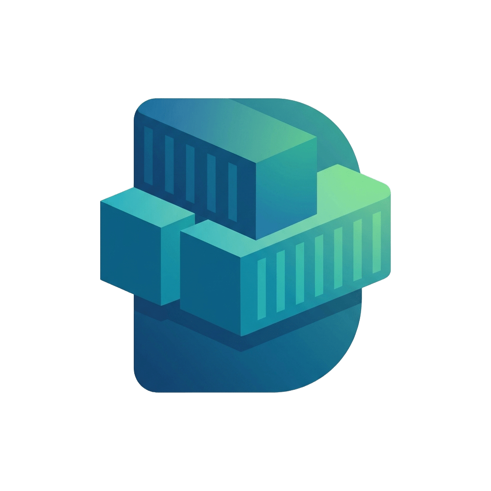

  

  # Dockyard — Container Engine

  **A beautiful, cross-platform desktop GUI for Docker and Kubernetes.**  
  
  
  
  

---

## ✨ Features

- 🐳 **Docker Management** — List, start, stop, restart, and delete containers in real-time
- 🖼️ **Images** — Browse and manage Docker images
- 🌐 **Networks** — Inspect Docker networks
- 💾 **Volumes** — View and manage Docker volumes
- 🧩 **Compose** — Monitor Docker Compose projects and their services
- ☸️ **Kubernetes** — View and delete pods across namespaces with live status
- 📟 **Live Logs** — Stream container and pod logs in an embedded terminal
- 💻 **Exec Shell** — Open an interactive shell inside any running container
- 🔍 **Command Palette** — Quick-search containers with `Ctrl+K`
- 🎨 **Dark / Light Theme** — Beautiful, modern UI with theme toggle
- 🖥️ **Frameless Window** — Custom titlebar with drag, minimize, maximize, and close

---

## 📦 Installation

Go to the [**Releases**](https://github.com/your-username/your-repo-name/releases) page and download the installer for your OS:

| OS | File | How to Install |
|---|---|---|
| **Linux (Debian/Ubuntu)** | `dockyard_x.x.x_amd64.deb` | `sudo dpkg -i dockyard_*.deb` |
| **Linux (Fedora/RHEL)** | `dockyard-x.x.x-1.x86_64.rpm` | `sudo rpm -i dockyard-*.rpm` |
| **Linux (Universal)** | `dockyard_x.x.x_amd64.AppImage` | `chmod +x dockyard_*.AppImage && ./dockyard_*.AppImage` |
| **macOS** | `dockyard_x.x.x_x64.dmg` | Open the `.dmg` and drag to Applications |
| **Windows** | `dockyard_x.x.x_x64-setup.exe` | Run the installer |

> **Prerequisites:** 
> - You must have **Docker Desktop** (macOS/Windows) or the **Docker daemon** (Linux) installed and running on your machine.
> - *(Optional)* For Kubernetes features, ensure `kubectl` is configured (i.e., `~/.kube/config` exists).

---

## 🚀 Getting Started

1. Start your Docker service or Docker Desktop.
2. Launch **Dockyard**.
3. The app will automatically connect to your local Docker socket and Kubernetes config and display your active containers and pods!

---

  Made with ❤️ using Tauri + Rust + React

